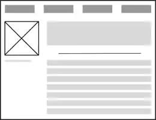

# Навчальний матеріал 3. Основи проєктування програмного забезпечення

> Джерело: **Object-Oriented Design**, University of Alberta (2017), с. 7–12. Переклад і редакційна адаптація оригіналу.

## Проєктування в процесі розробки

Розробка програмного забезпечення зазвичай відбувається за певним **процесом**: від розуміння проблеми переходять до створення програмного рішення. Цей процес **ітеративний** — деякі кроки повторюються, коли з’являються нові відомості або потрібно уточнити результат.

Після визначення вимог створюють попередні макети та технічні діаграми, а на їхній основі — програмну реалізацію. Потім результат перевіряють тестуванням. Такий цикл можна повторювати для наступних вимог.

Починати одразу з написання коду ризиковано. Реалізація спирається на припущення, які згодом буває складно змінити. Тому важливо виділяти час на з’ясування вимог і проєктування, навіть якщо початкові рішення ще не є остаточними.

## Концептуальне проєктування

**Концептуальне проєктування (conceptual design)** спирається на початкові вимоги та визначає:

- **компоненти**, які повинна містити майбутня система;
- **зв’язки** між цими компонентами;
- **відповідальності** кожного компонента — завдання, які він має виконувати.

На цьому етапі важливі загальні принципи роботи програми, а не конкретні технічні деталі.

Ідеї представляють за допомогою **концептуальних макетів (conceptual mock-ups)**. Для інтерфейсів користувача це можуть бути **каркасні макети (wireframes)** — схематичні зображення екранів без остаточного оформлення. Макети можна малювати від руки або створювати на комп’ютері.

*Оригінальна ілюстрація до концептуального проєктування, с. 10.*

Макет допомагає обговорювати рішення із замовником. Під час його створення можна помітити відсутні компоненти або зв’язки, які не працюватимуть належним чином. Тоді вимоги уточнюють, а проєкт переглядають.

### Приклад із будинком

Якщо проєктуємо будинок, компонентами можуть бути земельна ділянка, будинок і його кімнати. Зв’язки показують, як кімнати сполучаються одна з одною. **Відповідальність** будинку — забезпечити приміщення опорними конструкціями, водою та електрикою. **Відповідальність** кухні — передбачити місце для обладнання, посуду й продуктів, а також забезпечити воду та електроенергію для приготування їжі.

Але в концептуальному проєкті ще не потрібно вирішувати, де саме проходитимуть дроти та водопровідні труби.

## Технічне проєктування

**Технічне проєктування (technical design)** розвиває концептуальний проєкт: воно пояснює, **як саме** реалізувати визначені раніше відповідальності.

Великі компоненти розбивають на дедалі менші, доки кожна частина не стане достатньо конкретною для детального проєктування. Для передавання цих рішень команді використовують **технічні діаграми**, що показують структуру й поведінку компонентів.

У прикладі з будинком кухня сама є компонентом, але її потрібно розділити на складові, зокрема підлогу. Технічне проєктування може визначити, що покриття підлоги має легко очищуватися, адже на кухні готуватимуть їжу.

Важлива послідовність: **спочатку концептуальний проєкт, потім технічний**. Чим краще зрозуміла концепція, тим простіше деталізувати рішення.

## Уточнення рішень і компроміси

Іноді технічне рішення неможливо реалізувати так, як передбачалося на концептуальному рівні. Наприклад, власник будинку хоче відкриту кухню без перегородок, але конструкція другого поверху потребує опори саме в цьому місці. Доведеться узгодити компроміс.

Так само під час розробки програм **компоненти, зв’язки й відповідальності** переглядають, якщо вони не відповідають вимогам або технічно нездійсненні.

Чим більша система, тим більше часу зазвичай потрібно на проєктування. Коли рішення узгоджене, технічні діаграми стають основою реалізації. Окремі компоненти можна передати розробникам як керовані за розміром завдання.

---

*Джерело: University of Alberta, Object-Oriented Design (2017).*
