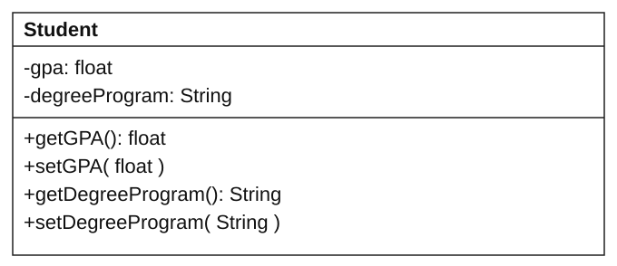

# Навчальний матеріал 4. Абстракція, інкапсуляція та декомпозиція

> Джерело: **Object-Oriented Design**, University of Alberta (2017), с. 29–34, 39–41. Український адаптований переклад матеріалу посібника.

## Чотири принципи об’єктно-орієнтованого проєктування

Посібник виділяє чотири важливі принципи:

1. **Абстракція (abstraction)**.
2. **Інкапсуляція (encapsulation)**.
3. **Декомпозиція (decomposition)**.
4. **Узагальнення (generalization)**.

У цьому матеріалі розглянемо перші три принципи. Узагальнення й відповідні UML-позначення наведено в наступному навчальному матеріалі.

## Абстракція

**Абстракція** допомагає описати поняття через **суттєві характеристики**, не включаючи деталі, які не потрібні для конкретної задачі.

Важливо враховувати **контекст**: ті самі об’єкти можуть потребувати різного опису залежно від того, яку систему ми створюємо. Для прикладу в посібнику розглянуто людину в контексті ігрового застосунку. Без пояснення ролі людини в грі складно визначити, які саме її характеристики потрібні.

Абстракція описує поняття через:

- **Атрибути (attributes)** — характеристики об’єкта.
- **Поведінку або відповідальності (behaviours / responsibilities)** — те, що об’єкт може або повинен виконувати.

### Приклад: лев

*Оригінальна ілюстрація до пояснення абстракції, с. 30.*

Уявімо програмну модель лева. Одним із його **атрибутів** може бути **вік**. Значення віку з часом змінюється, проте сама характеристика «вік» залишається частиною опису лева.

До **поведінки** лева належать, наприклад, полювання, харчування та сон. У моделі ці дії можна розглядати як його відповідальності: вони описують, що робить об’єкт, який представляє лева, у вибраному контексті.

Абстракція спрощує проєктування класів. Вона допомагає зосередитися на потрібних характеристиках і створювати моделі, зрозумілі іншим розробникам. Якщо задача або контекст змінюються, абстракції потрібно переглядати.

## Інкапсуляція

**Інкапсуляція** об’єднує пов’язані дані й операції над ними всередині самостійного об’єкта. Вона охоплює три ідеї:

- Дані та функції, які працюють із ними, **зібрані разом**.
- Частину даних і функцій можна **зробити доступною** іншим об’єктам.
- Доступ до частини даних і функцій можна **обмежити**.

Об’єкт повинен зберігати інформацію, що стосується саме його. Наприклад, модель лева може зберігати дані про здобич, на яку він полює, але їй не потрібно знати про всіх тварин, що живуть на іншому континенті.

Поведінку класу описують **методи**. Вони виконують дії, зокрема можуть змінювати значення атрибутів.

### «Чорна скринька»

Інкапсуляцію зручно пояснювати через поняття **чорної скриньки (black box)**. Іншим класам не обов’язково знати, як саме реалізовано обчислення всередині класу. Достатньо мати доступ до його відкритого інтерфейсу та знати, який результат очікувати.

Завдяки цьому реалізацію можна змінювати, зберігаючи поведінку, на яку покладаються інші компоненти.

## Керування доступом до даних

У UML-діаграмах класів можна показати доступ до атрибутів і методів:

- **`-`** — приватні члени, доступні лише всередині класу.
- **`+`** — публічні члени, доступні іншим класам.

У посібнику наведено приклад класу **`Student`**, у якого атрибути **`gpa`** і **`degreeProgram`** приватні, а для звернення до них передбачено публічні методи.

Отримувати й змінювати значення дозволяють два види методів:

- **Getter** — метод читання значення, зазвичай з назвою `get...`.
- **Setter** — метод зміни значення, зазвичай з назвою `set...`.

Ці методи допомагають контролювати доступ до даних і підтримувати їхню цілісність. Приклад і назви методів у цьому поясненні відповідають оригіналу на Java.

## Декомпозиція

**Декомпозиція** розділяє цілу систему на окремі частини або, навпаки, дозволяє розглядати взаємодію частин, з яких складається ціле. Кожна частина отримує власну відповідальність.

У посібнику розглядають три види відносин:

- **Асоціація (association)**.
- **Агрегація (aggregation)**.
- **Композиція (composition)**.

Ці зв’язки допомагають описувати, як об’єкти взаємодіють і наскільки сильно залежать один від одного. Розрізнення цих відносин важливе під час переходу від загальної концепції до конкретних класів.

---

*Джерело: University of Alberta, Object-Oriented Design (2017).*
