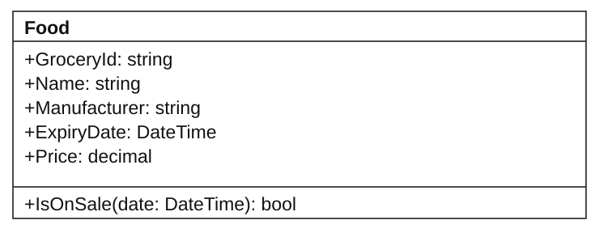

# UML, узагальнення та приховування інформації

## Навіщо потрібні діаграми класів

Під час розробки програмного забезпечення спочатку створюють **концептуальний проєкт**, а потім переходять до **технічного проєктування**.

Для обговорення загальної будови системи можна застосовувати **CRC-картки (Class, Responsibility, Collaborator)**. Вони дозволяють описувати класи, їхні відповідальності та взаємодію без необхідності одразу писати код.

Для технічного проєктування потрібне докладніше представлення структури програми. Одним із таких засобів є **UML-діаграма класів (UML class diagram)**.

Діаграми класів містять більше інформації, ніж CRC-картки. Вони допомагають показати будову класів і полегшують перехід від проєкту до програмної реалізації.

## Від абстракції до діаграми класів

**Абстракція** дозволяє спростити поняття до його суттєвих характеристик у певному контексті. В об’єктно-орієнтованій програмі ці характеристики можна визначити в класі.

Розглянемо **продукт у продуктовому магазині**. У CRC-картці класу **\`Food\`** можна зазначити відповідальності:

- знати ідентифікатор продукту;
- знати назву;
- знати виробника;
- знати термін придатності;
- знати ціну;
- визначати, чи продається продукт зі знижкою.

CRC-картка описує їх разом. Але під час створення класу слід розрізняти **дані** (характеристики продукту) і **методи** (дії, які він виконує).

### UML-діаграма класу

*Клас \`Food\`: публічні властивості та метод \`IsOnSale\`.*

На діаграмі клас зображують **прямокутником із трьома секціями**:

1. **Назва класу.**
2. **Атрибути або властивості.**
3. **Операції (методи).**

Запис атрибута має вигляд:

\`\`\`text
Назва: Тип
\`\`\`

Наприклад, **\`Price: double\`** означає властивість \`Price\` типу \`double\`. Знак \`+\` позначає **публічний доступ**.

Для операції використовують форму:

\`\`\`text
Назва(параметр: Тип): ТипРезультату
\`\`\`

Наприклад, **\`IsOnSale(date: DateTime): bool\`** описує метод, що приймає дату й повертає логічне значення \`true\` або \`false\`.

У C# назви класів, властивостей і методів зазвичай записують у стилі **PascalCase**, а параметри — у стилі **camelCase**. Тому при адаптації використано \`GroceryId\`, \`ExpiryDate\` та \`IsOnSale\` замість іншого написання ідентифікаторів.

### Перехід від UML до C#

У C# характеристики об’єкта часто представляють **властивостями (properties)**, а не публічними полями. Це дозволяє визначити доступ до читання й зміни даних.

\`\`\`csharp
public class Food
{
    public string GroceryId { get; set; } = string.Empty;
    public string Name { get; set; } = string.Empty;
    public string Manufacturer { get; set; } = string.Empty;
    public DateTime ExpiryDate { get; set; }
    public double Price { get; set; }

    public bool IsOnSale(DateTime date)
    {
        throw new NotImplementedException();
    }
}
\`\`\`

Метод \`IsOnSale\` показано **лише як частину структури класу**: умови надання знижки в цій моделі ще не визначено, тому його логіку не реалізовано. Це не готовий клас магазину.

**Назва класу** з діаграми стає назвою класу C#, **характеристики** — властивостями, а **операції** — методами. Можливе й зворотне перетворення: за програмним кодом можна побудувати UML-діаграму.

## Як UML показує інкапсуляцію

**Інкапсуляція** об’єднує дані та поведінку в одному класі й дозволяє визначати, які його члени доступні ззовні. На UML-діаграмах для цього використовують позначення:

| Позначення | Значення у C# |
|---|---|
| **\`+\`** | \`public\` — відкритий доступ |
| **\`-\`** | \`private\` — доступ лише всередині типу |
| **\`#\`** | \`protected\` — доступ усередині типу та його похідних класів |

### Приклад: клас Student

*Властивості \`Gpa\` і \`DegreeProgram\` та методи зміни їхніх значень.*

У C# для отримання й зміни характеристик зазвичай використовують **властивості з аксесорами \`get\` та \`set\`**:

- **\`get\`** повертає значення властивості;
- **\`set\`** змінює його значення.

Замість окремих методів \`GetGpa()\` і \`SetGpa(...)\` можна оголосити одну властивість \`Gpa\`.

Розглянемо клас:

\`\`\`csharp
public class Student
{
    public double Gpa { get; private set; }
    public string DegreeProgram { get; private set; } = string.Empty;

    public void UpdateGpa(double gpa)
    {
        Gpa = gpa;
    }

    public void UpdateDegreeProgram(string program)
    {
        DegreeProgram = program;
    }
}
\`\`\`

Із зовнішнього коду дозволено **прочитати** \`student.Gpa\`, але не можна безпосередньо виконати \`student.Gpa = 3.5\`, оскільки аксесор \`set\` позначено як **\`private\`**.

Змінити значення можна через відкритий метод \`UpdateGpa(...)\`. У цьому спрощеному прикладі метод лише присвоює значення. Якщо особливих правил зміни немає, окремий метод може бути зайвим, і достатньо звичайної автоматичної властивості з публічним \`set\`.

Таким чином, у C# **не потрібно автоматично переносити Java-підхід з окремими getter/setter-методами**: стандартний механізм доступу до даних — **властивості**.

> UML-діаграма показує публічну властивість. Деталь \`private set\` уточнюється в C#-коді; якщо це важливо для моделі, її можна додатково зазначити в обмеженнях до діаграми.

## Узагальнення

**Узагальнення (generalization)** — четвертий основний принцип об’єктно-орієнтованого проєктування.

Він дозволяє виділяти **спільні характеристики та поведінку** кількох класів в один загальніший клас, щоб не дублювати однаковий код.

У звичайному програмуванні повторно застосовувати певну поведінку можна за допомогою **методу**, який працює з різними вхідними даними.

В об’єктно-орієнтованому підході узагальнення можна реалізувати також **через успадкування (inheritance)**.

У C# розрізняють:

- **Базовий клас (base class)** — загальніший клас зі спільними характеристиками та поведінкою.
- **Похідний клас (derived class)** — спеціалізований клас, що успадковує доступні члени базового класу.

Підклас успадковує атрибути й поведінку суперкласу. Він також може мати власні додаткові характеристики та операції.

Кілька підкласів можуть успадковувати спільні члени від одного суперкласу. Якщо спільну реалізацію потрібно змінити, часто достатньо зробити це **один раз у суперкласі**.

Завдяки цьому зменшується повторення коду, а систему стає простіше розширювати й супроводжувати.

### Приклад: Animal і Lion

*Діаграма узагальнення: `Lion` успадковує члени класу `Animal`.*

Клас **`Animal`** — суперклас, а клас **`Lion`** — його підклас.

У UML успадкування зображують **суцільною лінією з порожнім трикутником**, який спрямований **до суперкласу**. Зазвичай загальний клас розміщують вище, а спеціалізований — нижче.

На діаграмі **базовий клас** \`Animal\` містить захищені властивості:

- \`#NumberOfLegs: int\`;
- \`#NumberOfTails: int\`;
- \`#Name: string\`.

А також публічні операції:

- \`+Walk(): void\`;
- \`+Run(): void\`;
- \`+Eat(): void\`.

Похідний клас \`Lion\` додає власну операцію **\`+Roar(): void\`**.

Успадковані члени **не потрібно повторно записувати** в прямокутнику похідного класу. Порожній трикутник на лінії узагальнення спрямований до базового класу.

## Успадкування у C#

У C# успадкування записують через **двокрапку \`:\`**, а виклик конструктора базового класу — через **\`base(...)\`**.

\`\`\`csharp
public abstract class Animal
{
    protected int NumberOfLegs { get; }
    protected int NumberOfTails { get; }
    protected string Name { get; }

    protected Animal(string name, int legs, int tails)
    {
        Name = name;
        NumberOfLegs = legs;
        NumberOfTails = tails;
    }

    public virtual void Walk()
    {
        Console.WriteLine("Animal is walking");
    }

    public void Run() { }
    public void Eat() { }
}

public class Lion : Animal
{
    public Lion(string name, int legs, int tails)
        : base(name, legs, tails)
    {
    }

    public override void Walk()
    {
        Console.WriteLine("I'd rather nap");
    }

    public void Roar() { }
}
\`\`\`

У прикладі \`Animal\` позначено як **\`abstract\`**, тому створити об’єкт безпосередньо через \`new Animal(...)\` не можна. Натомість можна створити екземпляр похідного класу \`Lion\`.

Конструктор \`Lion\` викликає конструктор \`Animal\` через \`base(name, legs, tails)\`, щоб ініціалізувати успадковану частину об’єкта. Порожні методи \`Run\`, \`Eat\` і \`Roar\` лише позначають операції моделі — їхню поведінку тут не деталізують.

### Перевизначення поведінки

У C# похідний клас може **перевизначити** реалізацію успадкованого методу, якщо метод базового класу позначений як **\`virtual\`** або **\`abstract\`**. У похідному класі при цьому використовують **\`override\`**.

У наведеному прикладі метод \`Walk()\` базового класу повідомляє, що тварина йде, а перевизначена версія \`Lion.Walk()\` — що лев волів би поспати.

Отже, успадкування дозволяє використовувати спільну поведінку й спеціалізувати її там, де це потрібно.

## Приховування інформації

**Приховування інформації (information hiding)** — важливий принцип організації програмних компонентів.

Не кожна частина системи повинна знати все про інші частини. **Модуль має отримувати лише ту інформацію, яка потрібна йому для виконання власного завдання.** Решту деталей варто приховувати.

Приховування інформації часто пов’язують із захистом конфіденційних даних. Проте в проєктуванні програм воно має також інше значення: **приховувати деталі, які можуть змінюватися**, зокрема алгоритми та способи представлення даних.

Натомість припущення та правила використання модуля, від яких залежать інші компоненти, мають бути відображені через **API або інтерфейс**.

### Чому це важливо

Уявімо, що два розробники працюють над різними модулями.

Якщо кожен модуль можна використовувати через визначений інтерфейс, одному розробнику **не потрібно знати всі внутрішні деталі** реалізації іншого модуля.

Таким чином різні частини системи можна розробляти та змінювати більш незалежно.

Загальний принцип:

- **Приховувати те, що може змінитися:** алгоритми, внутрішню реалізацію, представлення даних.
- **Відкривати те, на що покладаються інші компоненти:** доступний інтерфейс і очікувану поведінку.

## Зв’язок приховування інформації з інкапсуляцією

Інкапсуляція об’єднує атрибути й поведінку в класі та визначає, до яких із них дозволено звертатися ззовні.

Завдяки інкапсуляції інші класи використовують **сигнатури доступних методів** і очікувану поведінку, не знаючи внутрішньої реалізації цих методів.

Тому реалізацію можна змінювати, **не змінюючи результату**, на який розраховують користувачі класу.

Так само можна приховати **атрибути**. Якщо значення певного атрибута критично важливе для роботи класу, зовнішнім компонентам не варто дозволяти змінювати його безпосередньо.

## Модифікатори доступу у C#

Для обмеження доступу до полів, властивостей і методів C# використовує **модифікатори доступу**.

| Модифікатор | Доступ |
|---|---|
| **\`public\`** | Із будь-якого коду, для якого доступний сам тип |
| **\`private\`** | Усередині типу, який оголосив член |
| **\`protected\`** | Усередині типу та його похідних класів |
| **\`internal\`** | У межах тієї самої збірки (\`assembly\`) |
| **\`protected internal\`** | Із тієї самої збірки **або** з похідних класів в інших збірках |
| **\`private protected\`** | Із самого типу та похідних класів **у тій самій збірці** |

**\`public\`** дозволяє використовувати доступний член з інших типів. Однак виклик публічного методу не розкриває його внутрішнього алгоритму.

**\`private\`** приховує член від зовнішнього коду. Це корисно для внутрішніх деталей, які не повинні ставати частиною публічного інтерфейсу.

**\`protected\`** дозволяє похідним класам використовувати відповідні члени базового класу.

**\`internal\`** обмежує доступ межами **збірки .NET**, а не простору імен.

Якщо в C# **не вказати модифікатор доступу для поля чи методу класу**, за замовчуванням він матиме доступ **\`private\`**. Для звичайного класу, оголошеного безпосередньо в просторі імен, доступ за замовчуванням — **\`internal\`**.

### Приклад класу Person

\`\`\`csharp
public class Person
{
    private string _name;

    public Person(string name)
    {
        _name = name;
    }

    public string Name => _name;
}
\`\`\`

Поле **\`_name\`** приховане модифікатором **\`private\`**, а властивість **\`Name\`** дозволяє читати його значення. У такій простій моделі той самий результат можна отримати коротше за допомогою **автоматичної властивості**:

\`\`\`csharp
public class Person
{
    public string Name { get; private set; }

    public Person(string name)
    {
        Name = name;
    }
}
\`\`\`

Зовнішній код може прочитати \`Name\`, але не може змінити її через \`set\`, бо доступ до аксесора обмежено.

**Приховування інформації** означає, що користувачам класу відомий його доступний інтерфейс, але їм не потрібно залежати від способу зберігання даних усередині об’єкта.

