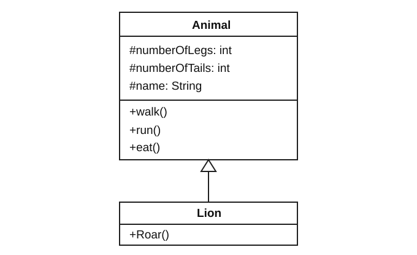

# Навчальний матеріал 5. UML, узагальнення та приховування інформації

> Джерело: **Object-Oriented Design**, University of Alberta (2017), с. 35–40, 46–47, 65–67. Український переклад і редакційна адаптація; позначення UML та програмні ідентифікатори збережено.

## Для чого використовують UML

**UML (Unified Modelling Language)** — мова для графічного представлення програмних моделей. Зокрема, **діаграми класів (class diagrams)** допомагають показувати структуру класів, їхні атрибути, операції та зв’язки.

Для кожного класу використовують прямокутник, який можна поділити на три частини:

1. **Назва класу (class name)**.
2. **Атрибути (properties / attributes)**.
3. **Операції (operations)**.

*Приклад із посібника, с. 37–39. Назви `Food`, `groceryID`, `name`, `manufacturer`, `expiryDate`, `price`, `isOnSale` не перекладаються.*

У діаграмі ім’я класу відповідає назві класу в коді Java. Атрибути описують змінні-члени та їхні типи, а операції — методи. За UML-діаграмою можна підготувати код, а за наявним кодом — створити діаграму класів.

У тексті посібника порівнюють UML-діаграми з **CRC-картками**: у CRC-картках відповідальності класу подають разом, тоді як діаграми класів допомагають відокремити атрибути від операцій.

## Узагальнення та успадкування

**Узагальнення (generalization)** дозволяє виділити спільні характеристики та поведінку кількох класів в один загальніший клас. Спеціалізовані класи можуть успадковувати ці характеристики й методи, тому не потрібно повторювати однаковий код.

Наприклад, із класів, що описують різних тварин, можна виділити спільний клас **`Animal`**, а **`Lion`** зробити його спеціалізацією.

*Схематично відтворено відношення узагальнення з оригінального посібника, с. 46–47; назви класів та UML-напрямок стрілки збережено.*

У UML узагальнення зображують **суцільною лінією зі стрілкою у вигляді порожнього трикутника**. Вона вказує від **підкласу (subclass)** до **суперкласу (superclass)**; зазвичай суперклас розташовують вище.

Підклас успадковує атрибути й поведінку суперкласу. Тому повторно записувати успадковані члени в прямокутнику підкласу не потрібно.

## Видимість членів класу на UML-діаграмах

Позначення перед членом класу показує його доступність:

- **`+` — public:** відкритий доступ.
- **`-` — private:** доступ лише всередині класу.
- **`#` — protected:** захищений доступ.

У прикладі **`Animal`** атрибути **`#numberOfLegs`**, **`#numberOfTails`** та **`#name`** позначені як захищені; методи **`+walk()`**, **`+run()`** і **`+eat()`** — як публічні. Підклас **`Lion`** має операцію **`+Roar()`**.

Потрібно пам’ятати, що вихідний посібник пояснює правила доступу **мови Java**. Зокрема, доступність `protected` у Java та C# не однакова. UML-позначення зберігають своє значення, але при перенесенні реалізації в іншу мову правила доступу необхідно враховувати окремо.

## Приховування інформації

**Приховування інформації (information hiding)** тісно пов’язане з інкапсуляцією. Клас об’єднує відповідні атрибути й поведінку та надає іншим компонентам доступ через визначений інтерфейс.

Інші класи можуть покладатися на **сигнатури доступних методів** і їхню очікувану поведінку, не знаючи деталей внутрішньої реалізації. Завдяки цьому реалізацію можна змінювати без зміни результатів, на які очікують користувачі класу.

Так само можна приховувати **атрибути**: це не дозволяє стороннім класам безпосередньо змінювати критично важливі дані. Спосіб забезпечити такий контроль — **модифікатори доступу**.

Посібник розглядає чотири рівні доступу у Java:

| Рівень | Пояснення в межах Java |
|---|---|
| `public` | Доступ з інших класів |
| `protected` | Доступ у класі, підкласах і класах того самого пакета |
| *default* (без модифікатора) | Доступ у межах того самого пакета |
| `private` | Доступ лише всередині класу |

**Важливо.** Таблиця передає правила Java, а не C#. У вихідному PDF опис доступу *default* для підкласів не зовсім точний: підклас поза пакетом не отримує доступу лише через успадкування. Тут це виправлено відповідно до реального значення доступу в Java, не додаючи нового розділу.

Суть приховування інформації — відокремити **те, що клас дозволяє робити**, від **того, як саме це реалізовано**. Це зменшує залежність інших класів від внутрішніх деталей.

---

*Джерело: University of Alberta, Object-Oriented Design (2017).*
