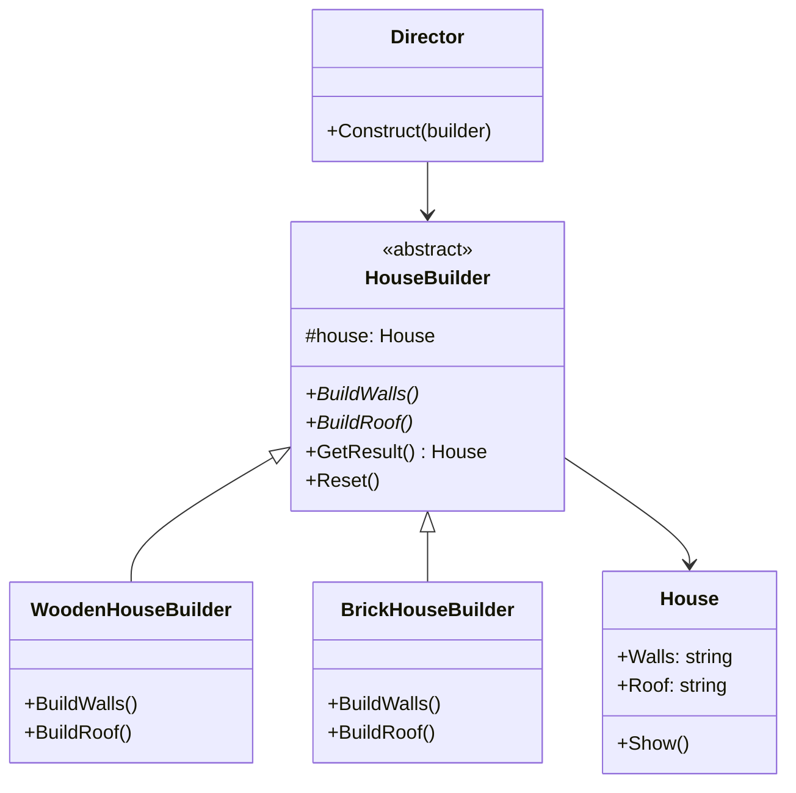

## Будівельник (Builder) — шаблон проєктування

**Builder** — це породжуючий шаблон, який інкапсулює створення складного об'єкта та дозволяє розділити процес побудови на етапи.

---

### 🛠 Коли варто використовувати:

* Коли процес створення об'єкта **не повинен залежати** від частин, з яких він складається, і від способу їх поєднання.
* Коли потрібно забезпечити **різні варіації** побудови об'єкта в рамках одного й того ж інтерфейсу.

---

### 📊 Формальна UML-структура:



---

### 💻 Приклад на C# (будівництво будинку):

```csharp
class House
{
    public string Walls { get; set; } = "";
    public string Roof { get; set; } = "";

    public void Show() =>
        Console.WriteLine($"Стіни: {Walls}, дах: {Roof}");
}

abstract class HouseBuilder
{
    protected House house = new();

    public abstract void BuildWalls();
    public abstract void BuildRoof();

    public House GetResult() => house;
    public void Reset() => house = new();
}

class WoodenHouseBuilder : HouseBuilder
{
    public override void BuildWalls() => house.Walls = "Дерев'яні";
    public override void BuildRoof() => house.Roof = "Дерев'яний";
}

class BrickHouseBuilder : HouseBuilder
{
    public override void BuildWalls() => house.Walls = "Цегляні";
    public override void BuildRoof() => house.Roof = "Черепичний";
}

class Director
{
    public void Construct(HouseBuilder builder)
    {
        builder.Reset();
        builder.BuildWalls();
        builder.BuildRoof();
    }
}

// Використання:
Director director = new();

HouseBuilder woodenBuilder = new WoodenHouseBuilder();
director.Construct(woodenBuilder);
House woodenHouse = woodenBuilder.GetResult();
woodenHouse.Show();

HouseBuilder brickBuilder = new BrickHouseBuilder();
director.Construct(brickBuilder);
House brickHouse = brickBuilder.GetResult();
brickHouse.Show();
```

Той самий `Director` виконує однакові етапи побудови, але конкретний будівельник визначає матеріали будинку. У цьому простому прикладі можна викликати методи будівельника напряму; `Director` показано як учасника класичної структури патерну.

---

### 👥 Учасники патерна:

* **House (Product)** — об'єкт, який створюється: будинок зі стінами та дахом.
* **HouseBuilder (Builder)** — абстрактний клас, що визначає етапи побудови та зберігає створюваний будинок.
* **WoodenHouseBuilder і BrickHouseBuilder (Concrete Builders)** — реалізації етапів для будинків із різних матеріалів.
* **Director** — визначає порядок виклику етапів побудови (необов'язковий учасник).

> 🔸 **Director — не обов'язковий.** Він виправданий, коли порядок або сценарії побудови потрібно використовувати повторно.

---

### 🥗 Приклад застосування (будівництво салату):

```csharp
class Ingredient {
    public string Name { get; set; }
    public string Amount { get; set; }
    public override string ToString() => $"{Amount} {Name}";
}

class Salad
{
    public string Name { get; set; }
    public List<Ingredient> Ingredients { get; } = new();
    public void Show() {
        Console.WriteLine($"Салат: {Name}");
        foreach (var i in Ingredients) Console.WriteLine($"- {i}");
    }
}

class SaladBuilder
{
    private readonly Salad salad = new();

    public SaladBuilder Named(string name) { salad.Name = name; return this; }
    public SaladBuilder Add(string name, string amount)
    {
        salad.Ingredients.Add(new Ingredient { Name = name, Amount = amount });
        return this;
    }
    public SaladBuilder AddTomato(int g) => Add("помідори", $"{g} г");
    public SaladBuilder AddCucumber(int g) => Add("огірки", $"{g} г");
    public SaladBuilder AddOil(string amt) => Add("оливкова олія", amt);
    public SaladBuilder AddSalt(string amt) => Add("сіль", amt);
    public Salad Build() => salad;
}

var salad = new SaladBuilder()
    .Named("Цезарь")
    .AddTomato(150)
    .AddCucumber(100)
    .AddOil("2 ст. ложки")
    .AddSalt("дрібка")
    .Build();

salad.Show();
```

---

### 🔁 Fluent chaining та Director

* **Fluent chaining** — це стиль, у якому методи повертають сам об’єкт, дозволяючи будувати ланцюжок викликів. Він добре підходить для читабельного конфігурування об'єктів:

```csharp
var salad = new SaladBuilder()
    .Named("Літній салат")
    .AddTomato(100)
    .AddCucumber(80)
    .AddOil("1 ст. ложка")
    .Build();
```

* **Director** — корисний, коли потрібно стандартизувати або повторно використовувати шаблони побудови:

```csharp
class SaladDirector
{
    public Salad MakeCaesar(SaladBuilder builder) =>
        builder.Named("Цезарь")
               .AddTomato(150)
               .AddCucumber(100)
               .AddOil("2 ст. ложки")
               .AddSalt("дрібка")
               .Build();
}
```

> Fluent chaining і Director можуть використовуватись окремо або разом, залежно від потреб архітектури.

---

### 🔧 Рекомендації щодо використання:

🟢 **Використовуйте Fluent chaining, якщо:**

* Вам потрібна гнучкість або нестандартні кроки побудови
* Ви цінуєте читабельність
* Клієнт безпосередньо керує побудовою об'єкта

🟦 **Використовуйте Director, якщо:**

* Вам потрібно забезпечити стандартизовану побудову
* Логіка побудови складна і її слід інкапсулювати

➡️ У більшості сучасних C#-додатків **Fluent Builder** виглядає інтуїтивніше та читається краще.
🔹 Однак, при потребі зручно мати **Director** як опціональний інструмент для повторного використання шаблонів.

---

---

### ❓ Чому використовують `abstract class Builder`, а не `interface`?

* Абстрактний клас дозволяє **зберігати стан**, наприклад, створюваний об'єкт (`Product`).
* Можна **реалізувати спільну логіку** (наприклад, `GetResult()` або `Reset()`) один раз у базовому класі.
* Підтримує **protected методи**, які можна використовувати у підкласах, але не виносити назовні.
* Підтримка **часткової реалізації**: можна частину методів реалізувати, а інші залишити абстрактними.
* Інтерфейс — лише контракт. Абстрактний клас — це і контракт, і часткова реалізація.

> 🔹 Якщо логіки в базовому класі немає, а лише контракт — тоді можна використовувати інтерфейс. Але у патерні Builder часто потрібен стан і логіка — тому абстрактний клас більш доречний.

---

На завершення, підсумуймо основні плюси й мінуси патерну Builder.

### ✅ Переваги:

Використання шаблону Builder дає такі переваги:

* **Гнучкість** — дає змогу поетапно створювати об'єкти з різною конфігурацією.
* **Ізоляція логіки побудови** — створення об’єкта не залежить від його частин та порядку складання.
* **Масштабованість** — легко додавати нові типи побудови без зміни існуючого коду.
* **Зрозумілий API** — завдяки fluent chaining інтерфейс побудови виглядає читаємо та інтуїтивно.

### ⚠️ Недоліки:

* Більше класів у структурі.
* Для простих об’єктів — надмірна складність.

🔚 У підсумку, патерн Builder — це зручний спосіб створювати складні об’єкти крок за кроком, не перевантажуючи конструктори й не порушуючи принципів SOLID.
