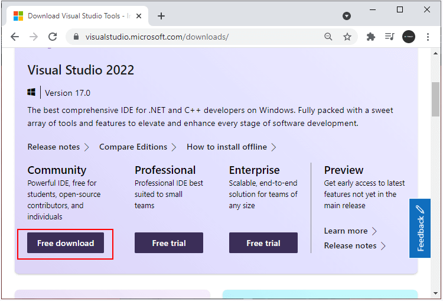
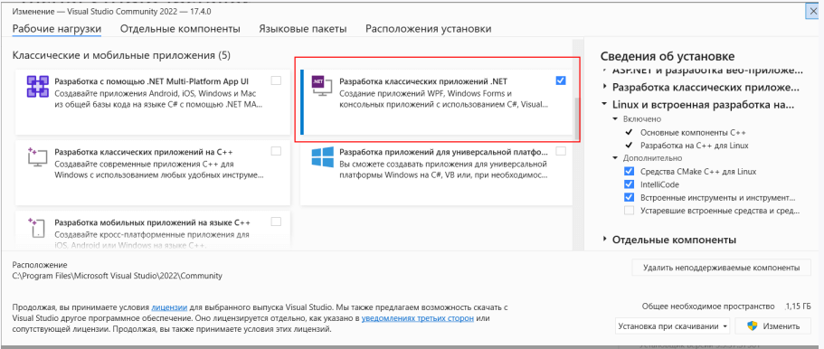
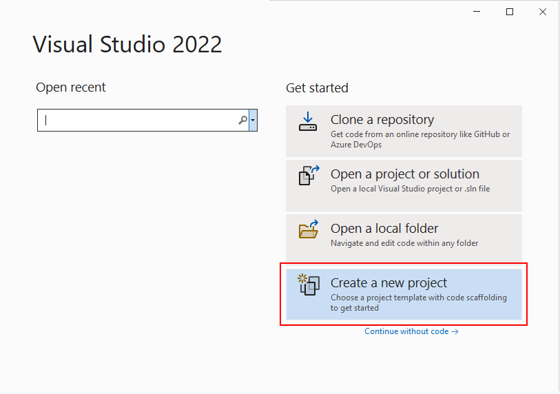
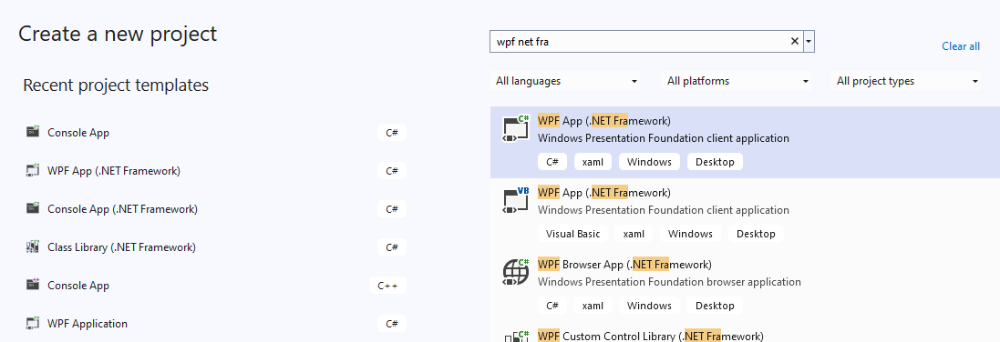
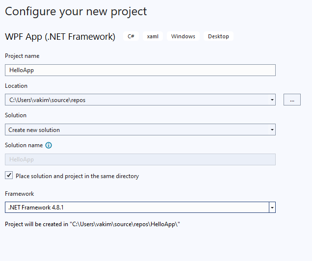
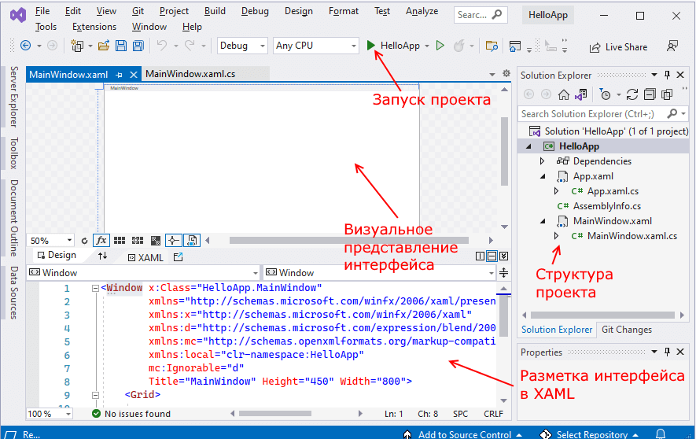

# Перший додаток у Visual Studio

Для створення програм за допомогою технології WPF ми можемо оцінити текстовий редактор і .NET CLI. Тим не менш, ми також можемо використовувати середовище розробки Visual Studio, яке в деяких аспектах забезпечує написання програм. Наприклад, візьмемо її безкоштовну та повнофункціональну версію - Visual Studio Community 2022, яку можна щодня завантажити за наступною адресою: https://visualstudio.microsoft.com/ru/downloads/.

Щоб додати до Visual Studio проекти підтримки для WPF, C# і .NET 7, у програмі встановлення серед робочих пристроїв необхідно вибрати тільки пункт «Розробка класичних програм .NET». Можна вибрати і більше опцій або взагалі всі опції, проте варто враховувати вільний розмір жорсткого диска – чим більше опцій буде вибрано, тим більше місця на диску буде зайнято.

Після встановлення середовища та всіх його компонентів, запустимо Visual Studio і створимо проект графічної програми. На стартовому екрані оберемо Create a new project (Створити новий проект)

B наступному вікні як тип проекту виберемо WPF Application:

Після цього Visual Studio відкриє проект із створеними за замовчуванням файлами:

