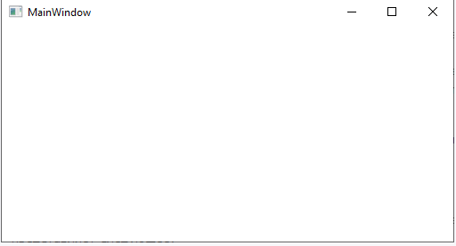

# Структура проекту

Справа знаходиться вікно Solution Explorer, в якому можна побачити структуру нашого проєкту. У цьому випадку у нас згенерована за замовчуванням структура, аналогічна тій, що створюється за допомогою .NET CLI:

- Dependencies — це вузол, який містить збірки dll, що додані до проєкту за замовчуванням. Ці збірки якраз містять класи бібліотеки .NET, які використовуватиме C#.

- App.xaml задає ресурси застосунку та низку конфігураційних налаштувань у вигляді коду XAML. Зокрема, у файлі App.xaml задається файл вікна програми, яке відкриватиметься під час запуску застосунку. Якщо відкрити цей файл, то можна знайти в ньому рядок StartupUri="MainWindow.xaml" — тобто в цьому випадку, коли ми запустимо застосунок, буде створено інтерфейс із файлу MainWindow.xaml.

- App.xaml.cs — це файл коду на C#, пов’язаний із файлом App.xaml, який також дозволяє задати низку загальних ресурсів та загальну логіку для застосунку, але у вигляді коду на C#.

- AssemblyInfo.cs містить інформацію про збірку, що створюється в процесі компіляції.

- MainWindow.xaml представляє візуальний інтерфейс вікна застосунку у вигляді коду XAML.

- MainWindow.xaml.cs — це файл логіки на C#, пов’язаний із вікном MainWindow.xaml.

За замовчуванням ці файли відкриті у текстовому редакторі Visual Studio. Причому файл MainWindow.xaml має два подання: візуальне — у режимі WYSIWYG відображає весь графічний інтерфейс цього вікна застосунку, і під ним декларативне оголошення інтерфейсу в XAML. Якщо ми змінимо декларативну розмітку, наприклад, визначимо там кнопку, то ці зміни відобразяться у візуальному поданні. Таким чином, ми зможемо одразу отримати уявлення про інтерфейс вікна застосунку.

## Запуск проекту

Щоб запустити програму в режимі налагодження, натисніть клавішу F5 або зелену стрілку на панелі Visual Studio. І після цього запуститься порожнє вікно за промовчанням.

