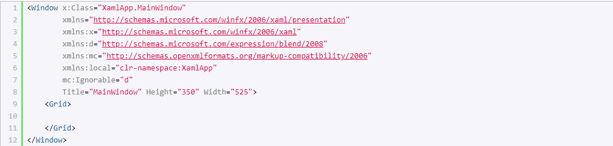
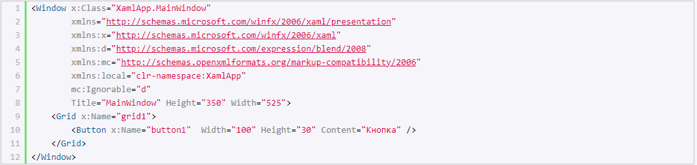
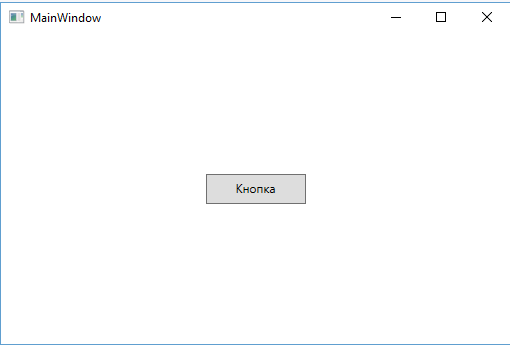

# XAML

## Введення в мову XAML

XAML (eXtensible Application Markup Language) — це мова розмітки, яка використовується для ініціалізації об'єктів у технологіях на платформі .NET. Щодо WPF (а також Silverlight), ця мова використовується насамперед для створення користувацького інтерфейсу декларативним шляхом. Хоча функціональність XAML не обмежується лише графічними інтерфейсами: ця мова також використовується в технологіях WCF і WF, де вона ніяк не пов’язана з графічним інтерфейсом. Тобто її застосування є ширшим. Щодо WPF, ми найчастіше будемо говорити про неї саме як про мову розмітки, яка дозволяє створювати декларативним шляхом інтерфейс, подібно до HTML у веб-програмуванні. Однак, знову ж таки, звужувати XAML тільки до інтерфейсу було б неправильно, і далі на прикладах ми це побачимо.

XAML не є обов’язковою частиною застосунку, ми взагалі можемо обійтися без нього, створюючи всі елементи у файлі пов’язаного з ним коду мовою C#. Однак використання XAML все ж таки має деякі переваги:

- Можливість відокремити графічний інтерфейс від логіки застосунку, завдяки чому над різними частинами застосунку можуть відносно автономно працювати різні фахівці: над інтерфейсом — дизайнери, над кодом логіки — програмісти.

- Компактність, зрозумілість, код на XAML відносно легко підтримувати.

Під час компіляції застосунку у Visual Studio код у xaml-файлах також компілюється у бінарне представлення коду XAML, яке називається BAML (Binary Application Markup Language). Потім код BAML вбудовується у фінальну збірку застосунку — exe або dll-файл.

### Структура та простори імен XAML

Під час створення нового проєкту WPF він уже містить файли з кодом XAML. Наприклад, створений за замовчуванням у проєкті файл MainWindow.xaml матиме таку розмітку:



Якщо ви зовсім не знайомі з XAML або XML, навіть цей невеликий мінімальний код вікна може викликати труднощі.

Подібно до структури веб-сторінки на HTML, тут є певна ієрархія елементів. Елементом верхнього рівня є Window, який представляє вікно застосунку. Під час створення інших вікон у застосунку нам завжди доведеться починати оголошення інтерфейсу з елемента Window, оскільки це елемент найвищого рівня.

Крім Window, існують ще два елементи верхнього рівня:

- Page

- Application

Елемент Window містить вкладений порожній елемент Grid, а також, подібно до HTML-елементів, має низку атрибутів (Title, Width, Height) — вони задають заголовок, ширину та висоту вікна відповідно.

### Простори імен XAML

При створенні коду мовою C#, щоб нам були доступні певні класи, ми підключаємо простори імен за допомогою директиви using, наприклад, using System.Windows;.

Щоб використовувати елементи у XAML, ми також підключаємо простори імен. Другий та третій рядки якраз і представляють простори імен, підключені до проєкту за замовчуванням. Атрибут xmlns є спеціальним атрибутом для визначення простору імен у XML.

Так, простір імен http://schemas.microsoft.com/winfx/2006/xaml/presentation містить опис і визначення більшості елементів керування. Оскільки він є простором імен за замовчуванням, то оголошується без префіксів.

http://schemas.microsoft.com/winfx/2006/xaml — це простір імен, який визначає деякі властивості XAML, наприклад, властивості Name або Key. Префікс x в оголошенні xmlns означає, що ті властивості елементів, які містяться в цьому просторі імен, будуть використовуватися з префіксом x — x:Name або x:Key. Це ж простір імен використовується в першому рядку x:Class="XamlApp.MainWindow" — тут створюється новий клас MainWindow і відповідний йому файл коду, де прописуватиметься логіка для цього вікна застосунку.

Це два основні простори імен. Розглянемо інші:

```xml
xmlns:d="http://schemas.microsoft.com/expression/blend/2008"
```

Цей простір імен надає підтримку атрибутів у режимі дизайнера. Він переважно призначений для іншого інструмента створення дизайну на XAML — Microsoft Expression Blend.

```xml
xmlns:mc="http://schemas.openxmlformats.org/markup-compatibility/2006"
```

Цей простір імен забезпечує режим сумісності розміток XAML. В оголошенні об'єкта Window двома рядками нижче можна знайти його використання:

```xml
mc:Ignorable="d"
```

Це вираження дозволяє ігнорувати парсерами XAML під час виконання застосунку дизайнерські атрибути з простору імен із префіксом <code>d</code>, тобто з <code>http://schemas.microsoft.com/expression/blend/2008</code>.

```xml
xmlns:local="clr-namespace:XamlApp"
```

Це простір імен поточного проєкту. Оскільки в цьому випадку проєкт називається XamlApp, то простір імен називається аналогічно. Через префікс <code>local</code> можна отримати в XAML різні об'єкти, визначені у проєкті.

Важливо розуміти, що ці простори імен не еквівалентні тим просторам імен, які підключаються за допомогою директиви using у C#. Наприклад, http://schemas.microsoft.com/winfx/2006/xaml/presentation підключає до проєкту такі простори імен:

- System.Windows

- System.Windows.Automation

- System.Windows.Controls

- System.Windows.Controls.Primitives

- System.Windows.Data

- System.Windows.Documents

- System.Windows.Forms.Integration

- System.Windows.Ink

- System.Windows.Input

- System.Windows.Media

- System.Windows.Media.Animation

- System.Windows.Media.Effects

- System.Windows.Media.Imaging

- System.Windows.Media.Media3D

- System.Windows.Media.TextFormatting

- System.Windows.Navigation

- System.Windows.Shapes

- System.Windows.Shell

### Елементи та їх атрибути

XAML пропонує дуже просту і зрозумілу схему визначення різних елементів та їхніх властивостей. Кожен елемент, як і будь-який елемент XML, повинен мати відкритий і закритий тег, як у випадку з елементом Window:

```xml
<Window></Window>
```

Або елемент може мати скорочену форму із закриваючим слешем наприкінці, подібно до:

```xml
<Window />
```

Але на відміну від елементів XML, кожен елемент у XAML відповідає певному класу C#. Наприклад, елемент Button відповідає класу System.Windows.Controls.Button. А властивості цього класу відповідають атрибутам елемента Button.



Спочатку йде елемент найвищого рівня — Window, потім іде вкладений елемент Grid — контейнер для інших елементів, і в ньому вже визначений елемент Button, який представляє кнопку.

Для кнопки ми можемо визначити властивості у вигляді атрибутів. Тут визначені атрибути x (ім'я кнопки), Width, Height та Content. Причому атрибут x береться у цьому випадку з простору імен "http://schemas.microsoft.com/winfx/2006/xaml", яке відповідає префіксу x. А інші атрибути не використовують префікси, тому беруться з основного простору імен "http://schemas.microsoft.com/winfx/2006/xaml/presentation".

Подібним чином ми можемо визначити й інші атрибути, які нам потрібні. Або ми можемо взагалі не визначати атрибути, і тоді будуть використані значення за замовчуванням.

Визначивши розмітку XAML, ми можемо запустити проєкт, і графічно відобразиться весь код XAML — тобто наша кнопка.



### Спеціальні символи

При визначенні інтерфейсу в XAML ми можемо зіткнутися з певними обмеженнями. Зокрема, ми не можемо використовувати спеціальні символи, такі як знак амперсанда &, лапки ", та кутові дужки < і >. Наприклад, якщо ми хочемо, щоб текст кнопки був таким: <"Hello">, у кнопки є властивість Content, яке задає вміст кнопки. Можна припустити, що треба написати так:

```xml
<Button Content="<"Hello">" />
```

Але такий варіант є помилковим і навіть не скомпілюється. У такому випадку потрібно використовувати спеціальні коди символів:

| Символ | Код |
| --- | --- |
| &lt; | &amp;lt; |
| &gt; | &amp;gt; |
| &amp; | &amp;amp; |
| " | &amp;quot; |

Наприклад:

```xml
<Button Content="&lt;&quot;Hello&quot;&gt;" />
```

#### Додавання пробілів

Ще одна проблема, з якою можемо зіткнутися в XAML — це додавання пробілів. Візьмемо, наприклад, таке визначення кнопки:

```xml
<Button>
```

    Hello         World

```xml
</Button>
```

Тут властивість Content задається неявно у вигляді вмісту між тегами <Button>...</Button>. Але, незважаючи на наявність кількох пробілів між словами "Hello" і "World", XAML за замовчуванням прибере всі ці пробіли. Щоб зберегти пробіли, потрібно використовувати атрибут xml:space="preserve":

```xml
<Button xml:space="preserve">
```

    Hello         World

```xml
</Button>
```

