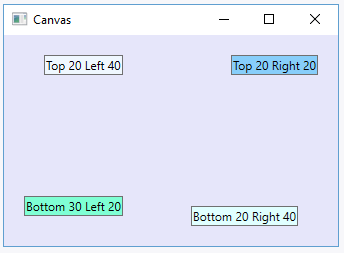

# Canvas

## Опис

Контейнер Canvas є найбільш простим контейнером. Для розміщення на ньому необхідно вказати для елементів точні координати відносно сторін Canvas.

## Основні властивості

| Властивість | Опис |
| --- | --- |
| <code>Canvas.Left</code> | Вказує, на скільки одиниць від лівого краю контейнера буде знаходитися елемент. |
| <code>Canvas.Right</code> | Вказує положення елемента відносно правого краю контейнера. |
| <code>Canvas.Top</code> | Вказує, на скільки одиниць нижче верхньої межі контейнера знаходиться елемент. |
| <code>Canvas.Bottom</code> | Вказує положення елемента відносно нижнього краю контейнера. |

## Особливості

- Як одиниці використовуються не пікселі, а незалежні від пристрою одиниці, які допомагають ефективно керувати масштабуванням елементів.
- Кожна така одиниця дорівнює 1/96 дюйма. При стандартному налаштуванні в 96 dpi ця незалежна одиниця дорівнює фізичному пікселю, оскільки 1/96 дюйма * 96 dpi = 1.
- При роботі на інших моніторах або при інших встановлених розмірах налаштування в додатку ефективно масштабуються. Наприклад, при роздільній здатності в 120 dpi одна умовна одиниця дорівнює 1,25 пікселя, оскільки 1/96 дюйма * 120 dpi = 1,25 пікселя.
- Якщо елемент не використовує властивості Canvas.Top та інші, то за замовчуванням Canvas.Left і Canvas.Top дорівнюють нулю, тобто він знаходиться у верхньому лівому куті.
- Не можна одночасно задавати Canvas.Left і Canvas.Right або Canvas.Bottom і Canvas.Top. Якщо таке трапиться, остання задана властивість не буде врахована.

## Приклад

~~~xml
<Window x:Class="Layout.MainWindow"
        xmlns="http://schemas.microsoft.com/winfx/2006/xaml/presentation"
        xmlns:x="http://schemas.microsoft.com/winfx/2006/xaml"
        Title="MainWindow" Height="300" Width="300">
    <Grid>
        <Canvas Background="Lavender">
            <Button Background="AliceBlue" Content="Top 20 Left 40" Canvas.Top="20" Canvas.Left="40" />
            <Button Background="LightSkyBlue" Content="Top 20 Right 20" Canvas.Top="20" Canvas.Right="20"/>
            <Button Background="Aquamarine" Content="Bottom 30 Left 20" Canvas.Bottom="30" Canvas.Left="20"/>
            <Button Background="LightCyan" Content="Bottom 20 Right 40" Canvas.Bottom="20" Canvas.Right="40"/>
        </Canvas>
    </Grid>
</Window>
~~~

