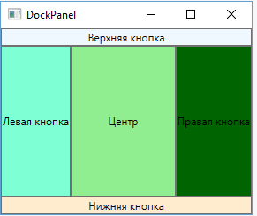
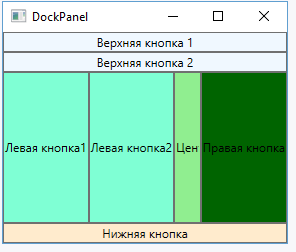

# DockPanel

## Опис

Цей контейнер притискає вкладені елементи до сторін зовнішнього контейнера.

## Основні властивості

| Властивість | Опис |
| --- | --- |
| <code>DockPanel.Dock</code> | Встановлює бік, до якого притискатиметься вкладений елемент. |
| <code>LastChildFill</code> | Якщо має значення <code>True</code>, останній елемент заповнює все залишкове місце. |

## Особливості

- Для останньої кнопки можна не встановлювати властивість DockPanel.Dock: вона заповнить весь залишковий простір, якщо LastChildFill має значення True.
- Якщо значення LastChildFill змінити на False, остання кнопка буде притиснута до лівого боку, заповнивши тільки те місце, яке їй необхідне.
- Порядок, у якому властивість DockPanel.Dock прикріплена до елементів, впливає на простір, який вони займають.
- Можна притиснути відразу кілька елементів в одну сторону. У цьому випадку вони будуть розташовані по порядку.
- DockPanel особливо зручно використовувати для створення стандартних інтерфейсів, де верхню і ліву частину можуть займати меню, нижню — рядок стану, праву — додаткова інформація, а в центрі буде основний зміст.

## Приклад

### Розміщення елементів

~~~xml
<Window x:Class="LayoutApp.MainWindow"
        xmlns="http://schemas.microsoft.com/winfx/2006/xaml/presentation"
        xmlns:x="http://schemas.microsoft.com/winfx/2006/xaml"
        xmlns:d="http://schemas.microsoft.com/expression/blend/2008"
        xmlns:mc="http://schemas.openxmlformats.org/markup-compatibility/2006"
        xmlns:local="clr-namespace:LayoutApp"
        mc:Ignorable="d"
        Title="DockPanel" Height="250" Width="300">
    <DockPanel LastChildFill="True">
        <Button DockPanel.Dock="Top" Background="AliceBlue" Content="Верхняя кнопка" />
        <Button DockPanel.Dock="Bottom" Background="BlanchedAlmond" Content="Нижняя кнопка" />
        <Button DockPanel.Dock="Left" Background="Aquamarine" Content="Левая кнопка" />
        <Button DockPanel.Dock="Right" Background="DarkGreen" Content="Правая кнопка" />
        <Button Background="LightGreen" Content="Центр" />
    </DockPanel>
</Window>
~~~

В результаті ми отримуємо масив кнопок, кожна з яких притискається до певної сторони елемента DockPanel:

### Вплив порядку елементів

Якщо змінити порядок елементів:

~~~xml
<DockPanel LastChildFill="True">
    <Button DockPanel.Dock="Top" Background="AliceBlue" Content="Верхняя кнопка" />
    <Button DockPanel.Dock="Left" Background="Aquamarine" Content="Левая кнопка" />
    <Button DockPanel.Dock="Right" Background="DarkGreen" Content="Правая кнопка" />
    <Button DockPanel.Dock="Bottom" Background="BlanchedAlmond" Content="Нижняя кнопка" />
    <Button Background="LightGreen" Content="Центр" />
</DockPanel>
~~~

У цьому випадку нижня кнопка буде заповнювати менший простір.

### Кілька елементів з одного боку

~~~xml
<DockPanel LastChildFill="True">
    <Button DockPanel.Dock="Top" Background="AliceBlue" Content="Верхняя кнопка 1" />
    <Button DockPanel.Dock="Top" Background="AliceBlue" Content="Верхняя кнопка 2" />
    <Button DockPanel.Dock="Bottom" Background="BlanchedAlmond" Content="Нижняя кнопка" />
    <Button DockPanel.Dock="Left" Background="Aquamarine" Content="Левая кнопка1" />
    <Button DockPanel.Dock="Left" Background="Aquamarine" Content="Левая кнопка2" />
    <Button DockPanel.Dock="Right" Background="DarkGreen" Content="Правая кнопка" />
    <Button Background="LightGreen" Content="Центр" />
</DockPanel>
~~~

