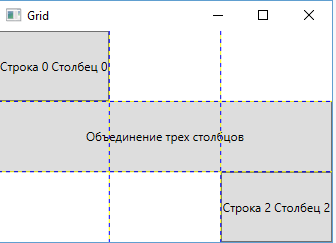
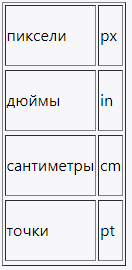
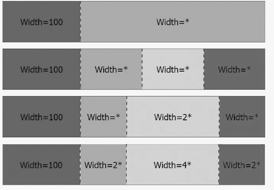

# Grid

## Опис

Це найбільш потужний і часто використовуваний контейнер, який нагадує звичайну таблицю. Він містить стовпці та рядки, кількість яких задає розробник.

## Основні властивості

| Властивість | Опис |
| --- | --- |
| <code>RowDefinitions</code> | Використовується для визначення рядків. |
| <code>ColumnDefinitions</code> | Використовується для визначення стовпців. |
| <code>Grid.Row</code> | Вказує рядок, у якому буде розташований елемент. |
| <code>Grid.Column</code> | Вказує стовпець, у якому буде розташований елемент. |
| <code>Grid.RowSpan</code> | Розтягує елемент управління на кілька рядків. |
| <code>Grid.ColumnSpan</code> | Розтягує елемент управління на кілька стовпців. |
| <code>ShowGridLines</code> | Задає видимість сітки; за замовчуванням має значення <code>False</code>. |
| <code>Height</code> | Задає висоту рядка. |
| <code>Width</code> | Задає ширину стовпця. |

## Особливості

- Кожен рядок задається за допомогою вкладеного елемента RowDefinition, який має відкриваючий і закриваючий тег. Додаткову інформацію вказувати необов'язково.
- Кожен стовпець задається за допомогою вкладеного елемента ColumnDefinition.
- Рядки та стовпці можуть мати автоматичні, абсолютні або пропорційні розміри.
- При автоматичному розмірі стовпець або рядок займає стільки місця, скільки йому потрібно.
- При абсолютному розмірі висота і ширина вказуються в одиницях, незалежних від пристрою. Також абсолютні розміри можна задати в пікселях, дюймах, сантиметрах або точках.
- Якщо рядок або стовпець має висоту або ширину, рівну *, то він буде займати все залишкове місце.
- Якщо є кілька рядків або стовпців з висотою або шириною *, то весь доступний простір розподіляється рівномірно між усіма такими рядками та стовпцями.
- Використання коефіцієнтів, наприклад 0.25*, дозволяє зменшити або збільшити виділене місце відповідно до цього коефіцієнта. Всі коефіцієнти складаються, коефіцієнт * еквівалентний 1*, і потім весь простір ділиться на суму коефіцієнтів.
- Можна комбінувати всі типи розмірів. У цьому випадку від ширини або висоти Grid віднімається ширина або висота стовпців чи рядків з абсолютними або автоматичними розмірами, а потім залишкове місце розподіляється між стовпцями чи рядками з пропорційними розмірами.

## Приклад

### Визначення рядків і стовпців

~~~xml
<Grid.RowDefinitions>
    <RowDefinition></RowDefinition>
    <RowDefinition></RowDefinition>
    <RowDefinition></RowDefinition>
</Grid.RowDefinitions>
<Grid.ColumnDefinitions>
    <ColumnDefinition></ColumnDefinition>
    <ColumnDefinition></ColumnDefinition>
    <ColumnDefinition></ColumnDefinition>
</Grid.ColumnDefinitions>
~~~

У цьому випадку визначено 3 рядки та 3 стовпці, тобто в результаті отримаємо таблицю 3x3.

### Розміщення елементів

Щоб задати позицію елемента управління з прив’язкою до певної клітинки Grid, у розмітці елемента потрібно вказати значення властивостей Grid.Column і Grid.Row. Якщо потрібно розтягнути елемент управління на кілька рядків або стовпців, можна вказати властивості Grid.ColumnSpan і Grid.RowSpan:

~~~xml
<Window x:Class="LayoutApp.MainWindow"
        xmlns="http://schemas.microsoft.com/winfx/2006/xaml/presentation"
        xmlns:x="http://schemas.microsoft.com/winfx/2006/xaml"
        xmlns:d="http://schemas.microsoft.com/expression/blend/2008"
        xmlns:mc="http://schemas.openxmlformats.org/markup-compatibility/2006"
        xmlns:local="clr-namespace:LayoutApp"
        mc:Ignorable="d"
        Title="Grid" Height="250" Width="350">
    <Grid ShowGridLines="True">
        <Grid.RowDefinitions>
            <RowDefinition></RowDefinition>
            <RowDefinition></RowDefinition>
            <RowDefinition></RowDefinition>
        </Grid.RowDefinitions>
        <Grid.ColumnDefinitions>
            <ColumnDefinition></ColumnDefinition>
            <ColumnDefinition></ColumnDefinition>
            <ColumnDefinition></ColumnDefinition>
        </Grid.ColumnDefinitions>
        <Button Grid.Column="0" Grid.Row="0" Content="Рядок 0 Стовпець 0"  />
        <Button Grid.Column="0" Grid.Row="1" Content="Об'єднання трьох стовпців" Grid.ColumnSpan="3"  />
        <Button Grid.Column="2" Grid.Row="2" Content="Рядок 2 Стовпець 2"  />
    </Grid>
</Window>
~~~

Тобто у нас вийде наступна картина:

### Встановлення розмірів

Якщо в попередньому прикладі рядки та стовпці були рівними один одному, то тепер спробуємо налаштувати стовпці за шириною, а рядки — за висотою.

#### Автоматичні розміри

~~~xml
<ColumnDefinition Width="Auto" />
<RowDefinition Height="Auto" />
~~~

#### Абсолютні розміри

~~~xml
<ColumnDefinition Width="150" />
<RowDefinition Height="150" />
~~~

~~~xml
<ColumnDefinition Width="1 in" />
<RowDefinition Height="10 px" />
~~~

#### Пропорційні розміри

Нижче задаються два стовпці, другий з яких має ширину в четверть від ширини першого:

~~~xml
<ColumnDefinition Width="*" />
<ColumnDefinition Width="0.25*" />
~~~

Наприклад, якщо у нас є три стовпці:

~~~xml
<ColumnDefinition Width="*" />
<ColumnDefinition Width="0.5*" />
<ColumnDefinition Width="1.5*" />
~~~

У цьому випадку сума коефіцієнтів дорівнює 1* + 0.5* + 1.5* = 3*. Якщо Grid має ширину 300 одиниць, то коефіцієнту 1* буде відповідати простір 300 / 3 = 100 одиниць. Тому перший стовпець матиме ширину 100 одиниць, другий — 100 * 0.5 = 50 одиниць, а третій — 100 * 1.5 = 150 одиниць.

