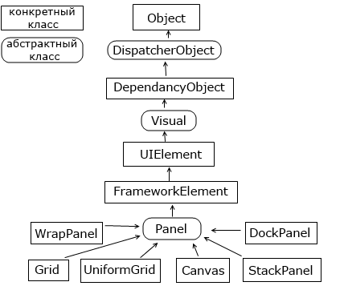

# Лекція № 2. Компонування

## Введення в компонування

Щоб перейти безпосередньо до створення красивих інтерфейсів і їх компонентів, спочатку необхідно ознайомитися з компоновкою. Компоновка (layout) являє собою процес розміщення елементів всередині контейнера. Можливо, ви звертали увагу, що деякі програми та вебсайти на різних екранах з різною роздільною здатністю виглядають по-різному: десь краще, десь гірше. У більшості таких програм використовуються жорстко закодовані в коді розміри елементів управління. WPF відходить від такого підходу на користь так званого "гумового дизайну", де весь процес позиціонування елементів здійснюється за допомогою компоновки.

Завдяки компоновці ми можемо зручним для нас способом налаштувати елементи інтерфейсу, розташувати їх певним чином. Наприклад, елементи компоновки у WPF дозволяють при зміні розміру вікна — зменшенні чи збільшенні — масштабувати елементи, що дуже зручно і візуально не створює таких недоліків, як незаповнені пустоти на формі.

У WPF компоновка здійснюється за допомогою спеціальних контейнерів. Фреймворк надає нам такі контейнери: Grid, UniformGrid, StackPanel, WrapPanel, DockPanel і Canvas.

Різні контейнери можуть містити всередині себе інші контейнери. Окрім цих контейнерів, існує ще низка елементів, таких як TabPanel, які можуть включати інші елементи та навіть контейнери компоновки, однак не мають такого впливу на саму компоновку, як вище перелічені. Крім того, якщо нам бракує стандартних контейнерів, ми можемо визначити власні з потрібною нам функціональністю.

Контейнери компоновки дозволяють ефективно розподілити доступний простір між елементами, знайти для них найбільш бажані розміри.

Усі вищезазначені контейнери компоновки наслідуються від абстрактного класу Panel, а саме дерево наслідування можна представити наступним чином:

У WPF при компоновці та розташуванні елементів всередині вікна слід дотримуватись наступних принципів:

Небажано вказувати явні розміри елементів (за винятком мінімальних і максимальних розмірів). Розміри повинні визначатися контейнерами.

Небажано вказувати явну позицію і координати елементів всередині вікна. Позиціонування елементів має бути повністю прерогативою контейнерів. Контейнер сам повинен визначати, як елемент буде розташовуватися. Якщо потрібно створити складну систему компоновки, можна вкладати один контейнер в інший, щоб досягти максимально зручного розташування елементів управління.

### Процес компоновки

Процес компоновки проходить два етапи: вимірювання (measure) і розстановка (arrange). На етапі вимірювання контейнер вимірює бажане для дочірніх елементів місце. Однак не завжди контейнер має достатньо місця, щоб розташувати всі елементи за їхніми бажаними розмірами, тому їх розміри можуть бути скорочені. Потім відбувається етап безпосередньої розстановки дочірніх елементів всередині контейнера.

Тепер розглянемо контейнери компоновки детальніше.

