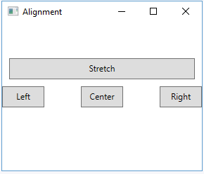
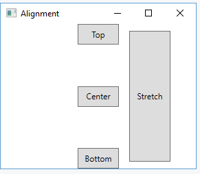
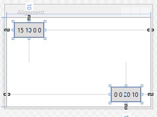
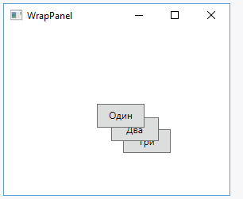

# Властивості компонування елементів

Елементи WPF мають набір властивостей, які допомагають позиціонувати ці елементи. Розглянемо деякі з цих властивостей.

## Ширина та висота

### Основні властивості

| Властивість | Опис |
| --- | --- |
| <code>Width</code> | Встановлює ширину елемента. |
| <code>Height</code> | Встановлює висоту елемента. |
| <code>MinWidth</code> | Встановлює мінімальну ширину елемента. |
| <code>MaxWidth</code> | Встановлює максимальну ширину елемента. |
| <code>MinHeight</code> | Встановлює мінімальну висоту елемента. |
| <code>MaxHeight</code> | Встановлює максимальну висоту елемента. |

Властивості <code>Width</code> і <code>Height</code> приймають значення типу <code>double</code>. Загальна рекомендація полягає в тому, щоб уникати жорстко закодованих значень ширини та висоти в коді.

За допомогою властивостей <code>MinWidth</code>, <code>MaxWidth</code>, <code>MinHeight</code> і <code>MaxHeight</code> можна задати можливий діапазон ширини та висоти. При розтягуванні або стисненні контейнерів елементи з цими властивостями не виходитимуть за межі встановлених значень.

### Одиниці вимірювання

У WPF можна використовувати кілька одиниць вимірювання:

| Одиниця | Позначення |
| --- | --- |
| Сантиметри | <code>cm</code> |
| Точки | <code>pt</code> |
| Дюйми | <code>in</code> |
| Пікселі | <code>px</code> |

Наприклад, задамо розміри в інших одиницях:

~~~xml
<Button Content="Кнопка" Width="5cm" Height="0.4in" />
~~~

Якщо одиниця вимірювання не вказана явно, а просто стоїть число, то за замовчуванням використовуються пікселі. Але ці пікселі не рівні звичайним пікселям, а є свого роду «логічними пікселями», незалежними від конкретного пристрою. Кожен такий піксель представляє 1/96 дюйма незалежно від роздільної здатності екрана.

## Вирівнювання

За допомогою спеціальних властивостей можна вирівняти елемент відносно певної сторони контейнера по горизонталі або вертикалі.

### HorizontalAlignment

Властивість <code>HorizontalAlignment</code> вирівнює елемент по горизонталі відносно правої чи лівої сторони контейнера.

| Значення | Опис |
| --- | --- |
| <code>Left</code> | Положення біля лівої сторони контейнера. |
| <code>Right</code> | Положення біля правої сторони контейнера. |
| <code>Center</code> | Положення по центру. |
| <code>Stretch</code> | Розтягнення на всю ширину. |

#### Приклад

~~~xml
<Grid>
    <Button Content="Left" Width="60" Height="30" HorizontalAlignment="Left" />
    <Button Content="Center" Width="60" Height="30" HorizontalAlignment="Center" />
    <Button Content="Right" Width="60" Height="30" HorizontalAlignment="Right" />
    <Button Content="Stretch" Height="30" HorizontalAlignment="Stretch" Margin="10 -80 10 0" />
</Grid>
~~~

### VerticalAlignment

Властивість <code>VerticalAlignment</code> задає вирівнювання елемента по вертикалі.

| Значення | Опис |
| --- | --- |
| <code>Top</code> | Положення зверху контейнера. |
| <code>Bottom</code> | Положення знизу контейнера. |
| <code>Center</code> | Положення по центру. |
| <code>Stretch</code> | Розтягнення на всю висоту. |

#### Приклад

~~~xml
<Grid>
    <Button Content="Bottom" Width="60" Height="30" VerticalAlignment="Bottom" />
    <Button Content="Center" Width="60" Height="30" VerticalAlignment="Center" />
    <Button Content="Top" Width="60" Height="30" VerticalAlignment="Top" />
    <Button Content="Stretch" Width="60" VerticalAlignment="Stretch" Margin="150 10 0 10" />
</Grid>
~~~

## Відступи Margin

Властивість <code>Margin</code> встановлює відступи навколо елемента.

Синтаксис:

~~~text
Margin="лівий відступ верхній відступ правий відступ нижній відступ"
~~~

Наприклад, встановимо відступи в однієї кнопки ліворуч і зверху, а в іншої кнопки — праворуч і знизу:

~~~xml
<Grid>
    <Button Content="15 10 0 0" Width="60" Height="30" Margin="15 10 0 0"
            HorizontalAlignment="Left" VerticalAlignment="Top" />
    <Button Content="0 0 20 10" Width="60" Height="30" Margin="0 0 20 10"
            HorizontalAlignment="Right" VerticalAlignment="Bottom" />
</Grid>
~~~

## Накладання елементів: Panel.ZIndex

Під час створення інтерфейсу може виникнути ситуація, коли одні елементи частково або повністю перекривають інші. За замовчуванням елементи, які визначені пізніше, перекривають ті, що були визначені раніше. Цю поведінку можна змінити за допомогою властивості <code>Panel.ZIndex</code>.

За замовчуванням для всіх створюваних елементів значення <code>Panel.ZIndex</code> дорівнює <code>0</code>. Призначивши цій властивості більше значення, можна перемістити елемент на передній план. Елементи з більшим значенням цієї властивості перекриватимуть ті, у яких значення менше.

### Приклад

~~~xml
<Grid>
    <Button Width="60" Height="30" Panel.ZIndex="2" Margin="10 10 0 0">Один</Button>
    <Button Width="60" Height="30" Panel.ZIndex="1" Margin="45 45 0 0">Два</Button>
    <Button Width="60" Height="30" Panel.ZIndex="0" Margin="75 75 0 0">Три</Button>
</Grid>
~~~

