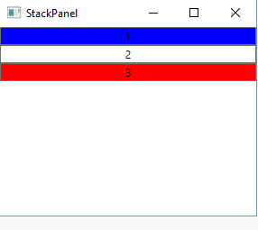

# StackPanel

## Опис

Це найпростіший елемент компонування. Він має всі елементи в ряд або по горизонталі, або по вертикалі залежно від орієнтації.

## Основні властивості

| Властивість | Опис |
| --- | --- |
| <code>Orientation</code> | Визначає вертикальне або горизонтальне розташування елементів. За замовчуванням використовується значення <code>Vertical</code>. |
| <code>FlowDirection</code> | Визначає напрямок розташування елементів. За замовчуванням має значення <code>LeftToRight</code>. |

## Особливості

- При вертикальній орієнтації StackPanel створює вертикальний ряд, який містить усі вкладені елементи зверху вниз.
- При горизонтальній орієнтації всі вкладені елементи розташовуються праворуч.
- Щоб наповнення горизонтального стека починалося справа наліво, потрібно задати властивість FlowDirection зі значенням RightToLeft.

## Приклад

~~~xml
<Window x:Class="LayoutApp.MainWindow"
        xmlns="http://schemas.microsoft.com/winfx/2006/xaml/presentation"
        xmlns:x="http://schemas.microsoft.com/winfx/2006/xaml"
        xmlns:d="http://schemas.microsoft.com/expression/blend/2008"
        xmlns:mc="http://schemas.openxmlformats.org/markup-compatibility/2006"
        xmlns:local="clr-namespace:LayoutApp"
        mc:Ignorable="d"
        Title="StackPanel" Height="300" Width="300">
    <Grid>
        <StackPanel>
            <Button Background="Blue" Content="1" />
            <Button Background="White" Content="2" />
            <Button Background="Red" Content="3" />
        </StackPanel>
    </Grid>
</Window>
~~~

Для встановлення горизонтального стека потрібно вказати властивість Orientation="Horizontal". Щоб наповнення стека починалося справа наліво, потрібно задати:

~~~xml
<StackPanel Orientation="Horizontal" FlowDirection="RightToLeft">
~~~

