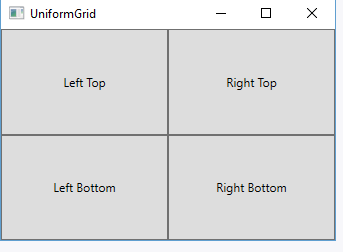

# UniformGrid

## Опис

Контейнер UniformGrid подібний до Grid, але в цьому випадку всі стовпці та рядки мають однаковий розмір, і використовується спрощений синтаксис для їх визначення.

## Основні властивості

| Властивість | Опис |
| --- | --- |
| <code>Rows</code> | Кількість рядків. |
| <code>Columns</code> | Кількість стовпців. |
| <code>FirstColumn</code> | Кількість порожніх комірок на початку першого рядка. |

## Особливості

- У UniformGrid всі клітинки мають однаковий розмір, що може бути корисно, коли потрібно створити просту і рівномірну сітку елементів.
- Не потрібно задавати конкретні розміри для рядків і стовпців, оскільки UniformGrid автоматично розподіляє простір рівномірно між усіма клітинками.

## Приклад

~~~xml
<UniformGrid Rows="2" Columns="2">
    <Button Content="Left Top" />
    <Button Content="Right Top" />
    <Button Content="Left Bottom" />
    <Button Content="Right Bottom" />
</UniformGrid>
~~~

