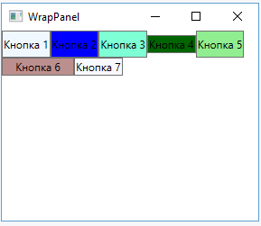

# WrapPanel

## Опис

Ця панель, подібно до StackPanel, розташовує всі елементи в одному рядку або стовпці залежно від значення властивості Orientation.

## Основні властивості

| Властивість | Опис |
| --- | --- |
| <code>Orientation</code> | Визначає горизонтальне або вертикальне розташування елементів. |
| <code>ItemWidth</code> | Встановлює певну ширину для всіх вкладених елементів. |
| <code>ItemHeight</code> | Встановлює певну висоту для всіх вкладених елементів. |

## Особливості

- Головна відмінність від StackPanel полягає в тому, що якщо елементи не вміщуються в рядку або стовпці, створюються новий стовпець або рядок для тих елементів, що не помістилися.
- У горизонтальному стеку елементи, у яких явно не встановлена висота, автоматично прийматимуть висоту найбільшого елемента зі стека.
- У вертикальному стеку елементи, у яких явно не вказана ширина, автоматично приймають ширину найширшого елемента.

## Приклад

~~~xml
<WrapPanel>
    <Button Background="AliceBlue" Content="Кнопка 1" />
    <Button Background="Blue" Content="Кнопка 2" />
    <Button Background="Aquamarine" Content="Кнопка 3" Height="30"/>
    <Button Background="DarkGreen" Content="Кнопка 4" Height="20"/>
    <Button Background="LightGreen" Content="Кнопка 5"/>
    <Button Background="RosyBrown" Content="Кнопка 6" Width="80" />
    <Button Background="GhostWhite" Content="Кнопка 7" />
</WrapPanel>
~~~

